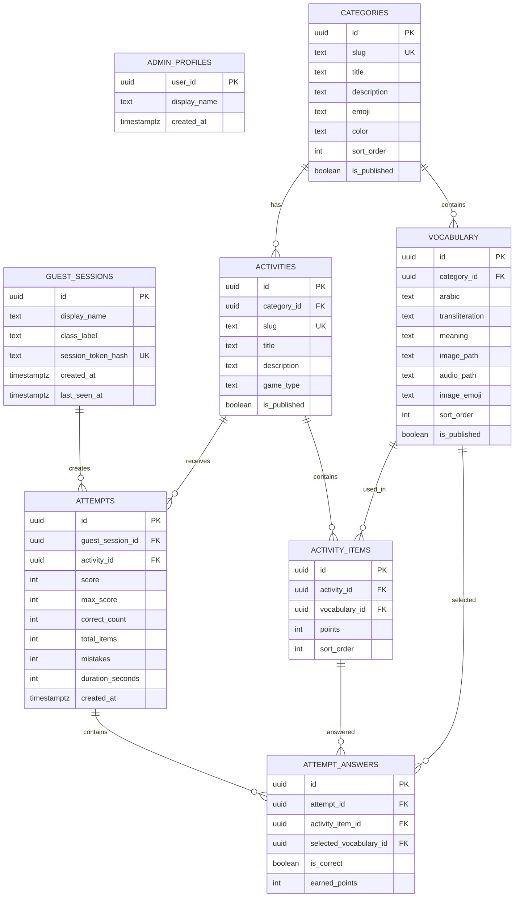

# Mufrodat Kids — ERD

## Security model

- Admin memakai Supabase Auth dan harus memiliki baris pada `admin_profiles`.
- Konten yang berstatus `is_published = true` dapat dibaca publik.
- Mutasi kategori, kosakata, permainan, dan media hanya dapat dilakukan admin.
- Guest session dan hasil permainan tidak memiliki kebijakan baca/tulis publik.
- Next.js Route Handler menggunakan service role hanya di server, memverifikasi hash token guest, mengambil kunci jawaban dari `activity_items`, lalu menghitung skor.
- `session_token_hash` disimpan di database. Token asli hanya dikirim ke browser pembuat sesi.

## Catatan desain

Mode guest menyimpan identitas pada browser. Satu siswa dapat menggunakan nama panggilan yang sama di sesi berbeda. Untuk laporan yang dapat dikenali lintas perangkat, aplikasi perlu beralih ke akun siswa atau kode akses yang dikelola guru.
